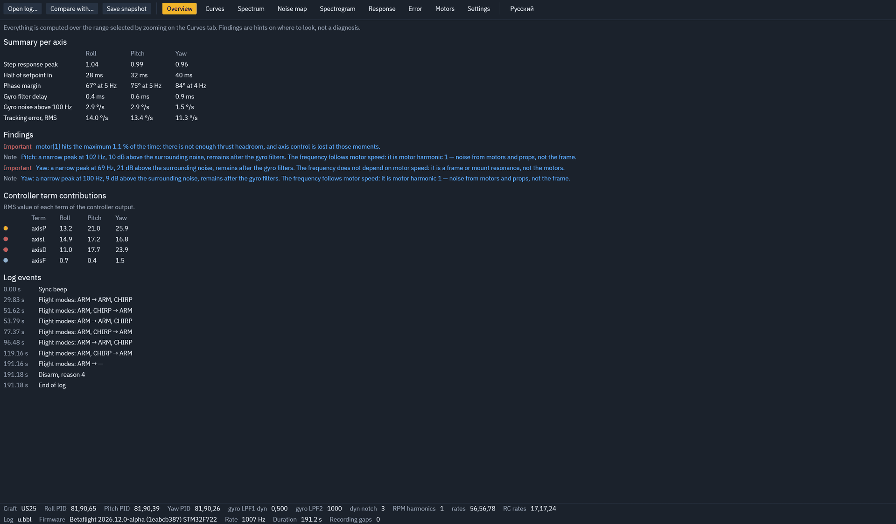
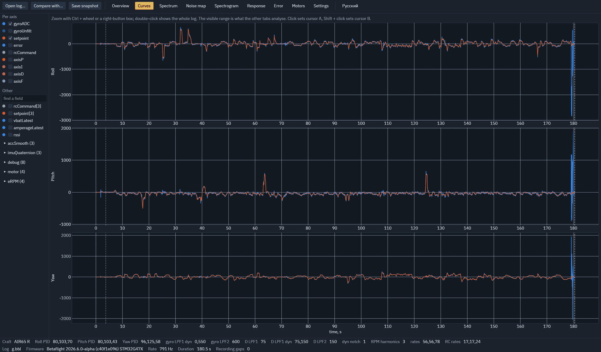
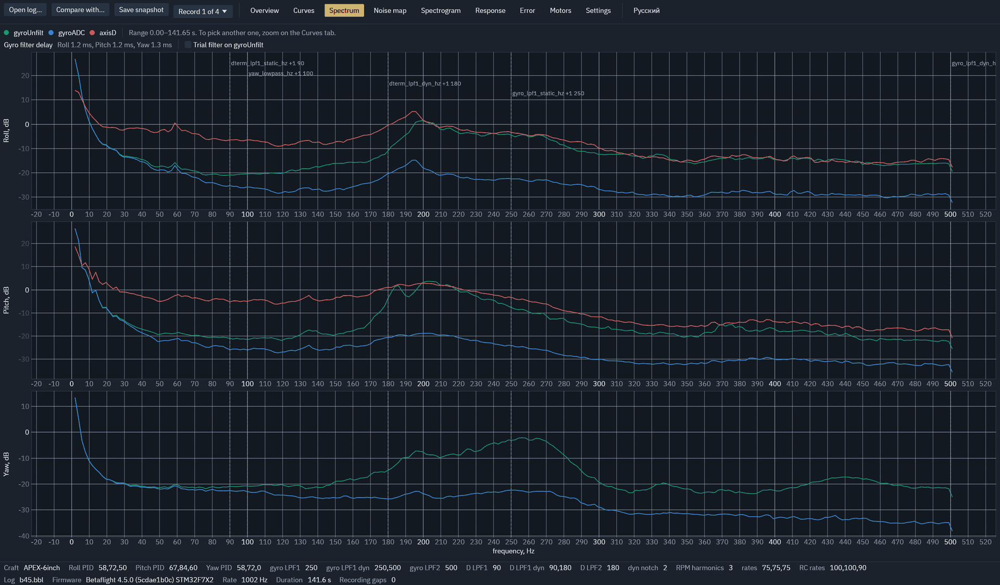
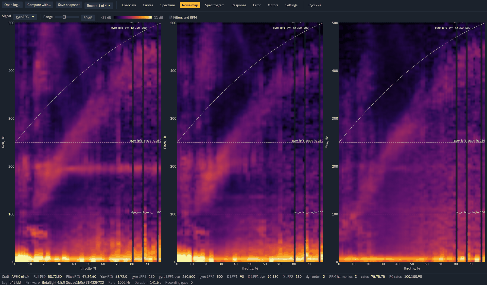
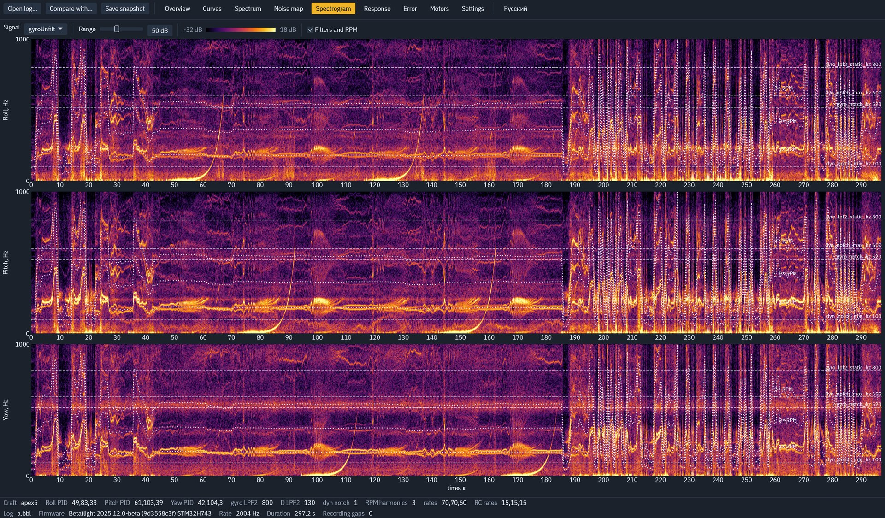
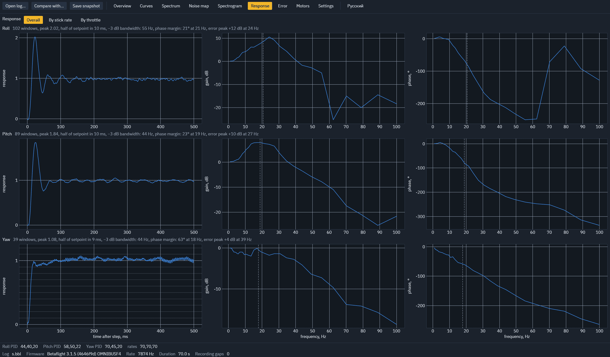
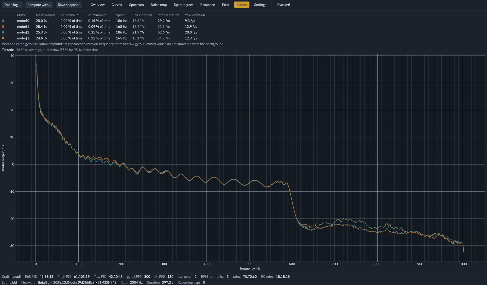

# FPV Log Analyzer

**English** · [Русский](README.ru.md)

**Support the project:**
[Boosty](https://boosty.to/danusha/donate) ·
USDT (TRON / TRC-20) `THyBqiMTWQ7kUH6vVBEdboL7yGLj5mCSrX` ·
GRAM / TON `UQDOgjGljFVJiHo_c9JLuX4hF2UQ2SXqSXhj3-1RefFMA4tB`

A blackbox log analyzer for FPV drones: charts that help you find the cause of
a problem — noise, filters, response, motors. Not an autotuner. Linux and
Windows, a single executable.

Reads logs from Betaflight (3.x – 2026.x), INAV, EmuFlight and Rotorflight,
including logs with non-standard fields. The interface is available in English
and Russian: it follows the system language and can be switched from the top bar.



## Run

Download a build for Linux or Windows from the releases page, or build from source:

```bash
cargo run --release -- path/to/log.bbl
```

You can also drop a log onto the window or use the "Open log…" button.

## What it shows

| Tab | Contents |
|---|---|
| Overview | Per-axis summary; findings (each links to its tab): whether a peak comes from motors or the frame, prop wash, phase margin, motor saturation; what to enable in the firmware for a better log |
| Curves | Signals per Roll / Pitch / Yaw. The time zoom selects the range for the rest of the analysis; two cursors measure an interval and its frequency |
| Spectrum | Noise before and after filters, filter cutoffs and delay, a two-stage trial filter (PT1–PT3, biquad) |
| Noise map | Noise vs throttle or motor RPM, with filter cutoffs and RPM harmonics overlaid |
| Spectrogram | Noise over time |
| Response | Step response, gain and phase, phase margin; split by stick rate or by throttle |
| Error | Tracking error and how it depends on stick rate |
| Motors | Load, saturation, vibration at each motor's rotation frequency |
| Settings | Parameters from the log; differences between two logs when comparing |

"Compare with…" overlays up to three more logs on the spectrum and the response;
"Save snapshot" writes a PNG next to the log. The language, the last folder and
the chosen fields are remembered between runs.








## Without a window

```bash
fpv-log-analyzer log.bbl report      # findings and events as text
fpv-log-analyzer log.bbl csv         # the record as CSV
fpv-log-analyzer log.bbl response    # spectra, delay, response and margins as a table
fpv-log-analyzer log.bbl step+save   # a PNG snapshot of a tab
```

## Build and test

```bash
cargo build --release                                   # Linux
cargo build --release --target x86_64-pc-windows-gnu    # Windows
cargo test --release
```

## License

GPL-3.0-or-later, see [LICENSE](LICENSE). The interface font is IBM Plex Sans (SIL OFL 1.1).
