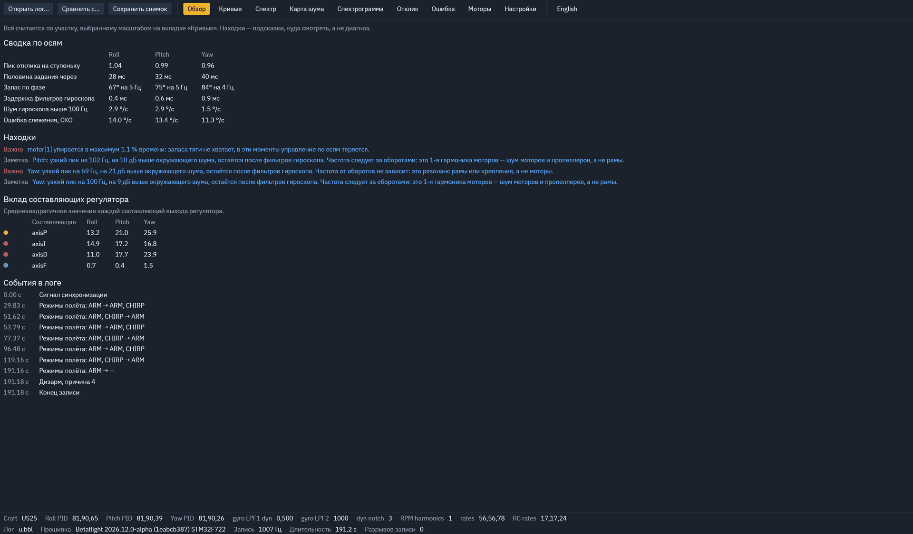
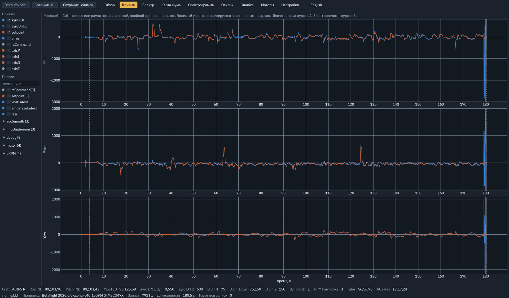
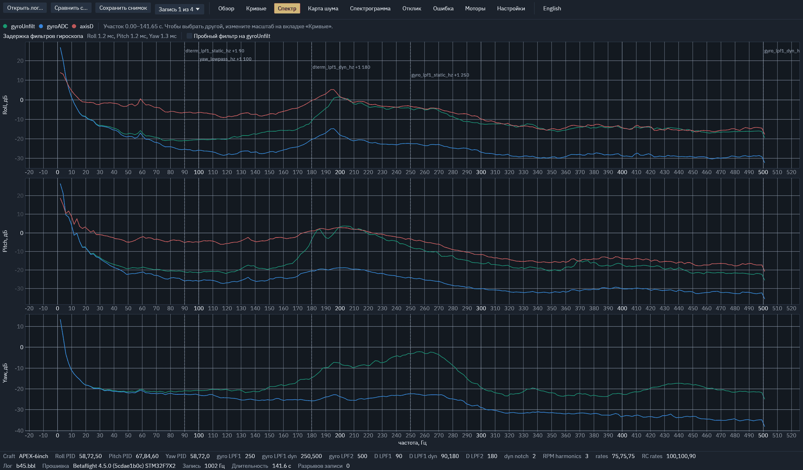
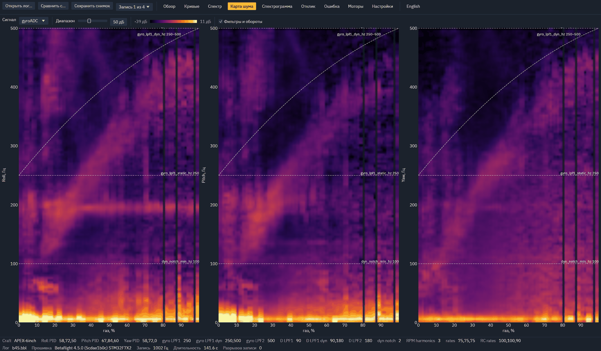
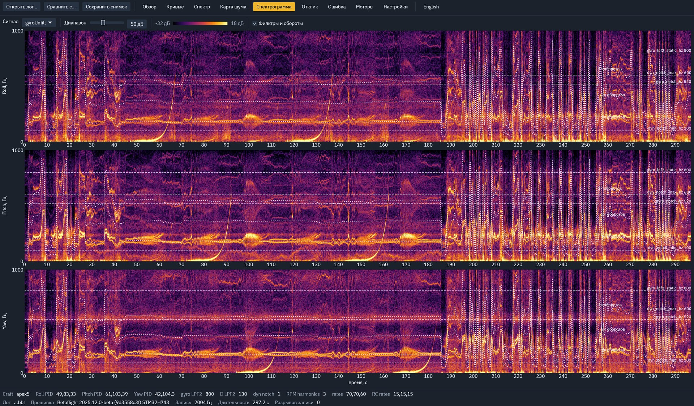
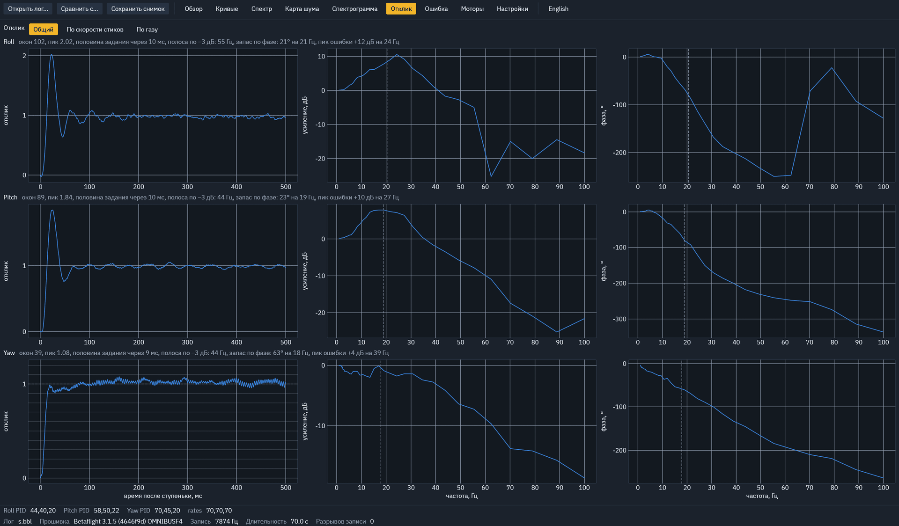
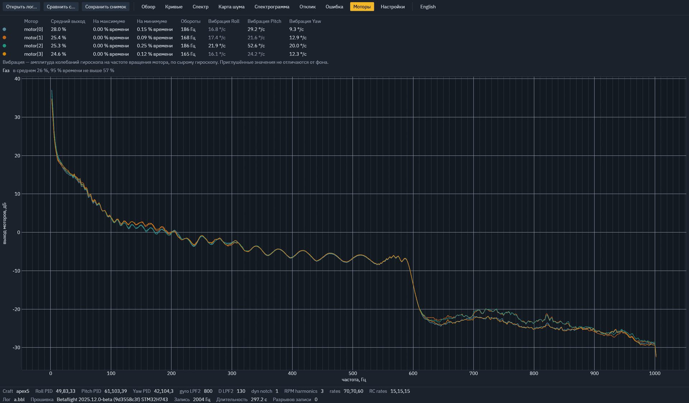

# FPV Log Analyzer

[English](README.md) · **Русский**

**Поддержать проект:**
[Boosty](https://boosty.to/danusha/donate) ·
USDT (TRON / TRC-20) `THyBqiMTWQ7kUH6vVBEdboL7yGLj5mCSrX` ·
GRAM / TON `UQDOgjGljFVJiHo_c9JLuX4hF2UQ2SXqSXhj3-1RefFMA4tB`

Анализатор blackbox-логов FPV-дронов: по графикам помогает найти причину
проблемы — шум, фильтры, отклик, моторы. Не автотюнер. Linux и Windows,
один исполняемый файл.

Читает логи Betaflight (3.x – 2026.x), INAV, EmuFlight и Rotorflight, в том
числе с нестандартными полями. Интерфейс — на русском и английском: язык берётся
из системы и переключается кнопкой в верхней панели.



## Запуск

Готовые сборки для Linux и Windows — на странице релизов. Либо из исходников:

```bash
cargo run --release -- путь/к/логу.bbl
```

Лог можно перетащить в окно или открыть кнопкой «Открыть лог…».

## Что показывает

| Вкладка | Содержание |
|---|---|
| Обзор | Сводка по осям; находки (каждая ведёт на свою вкладку): чей пик — моторов или рамы, prop wash, запас по фазе, насыщение моторов; что включить в прошивке, чтобы лог был полнее |
| Кривые | Сигналы по Roll / Pitch / Yaw. Масштаб по времени задаёт участок для остального анализа; два курсора измеряют интервал и его частоту |
| Спектр | Шум до и после фильтров, частоты и задержка фильтров, пробный фильтр из двух ступеней (PT1–PT3, biquad) |
| Карта шума | Шум от газа или оборотов; поверх — срезы фильтров и гармоники оборотов |
| Спектрограмма | Шум во времени |
| Отклик | Отклик на ступеньку, усиление и фаза, запас по фазе; раздельно по скорости стиков и по газу |
| Ошибка | Ошибка слежения и её зависимость от скорости стиков |
| Моторы | Загрузка, насыщение, вибрация на частоте вращения каждого мотора |
| Настройки | Параметры из лога; при сравнении — отличия двух логов |

«Сравнить с…» накладывает до трёх логов на спектр и отклик, «Сохранить снимок»
пишет PNG рядом с логом. Язык, последняя папка и выбранные поля запоминаются
между запусками.








## Без окна

```bash
fpv-log-analyzer лог.bbl report      # находки и события текстом
fpv-log-analyzer лог.bbl csv         # запись в CSV
fpv-log-analyzer лог.bbl response    # спектры, задержка, отклик, запасы таблицей
fpv-log-analyzer лог.bbl step+save   # снимок вкладки в PNG
```

## Сборка и проверка

```bash
cargo build --release                                   # Linux
cargo build --release --target x86_64-pc-windows-gnu    # Windows
cargo test --release
```

## Лицензия

GPL-3.0-or-later, см. [LICENSE](LICENSE). Шрифт интерфейса — IBM Plex Sans (SIL OFL 1.1).
